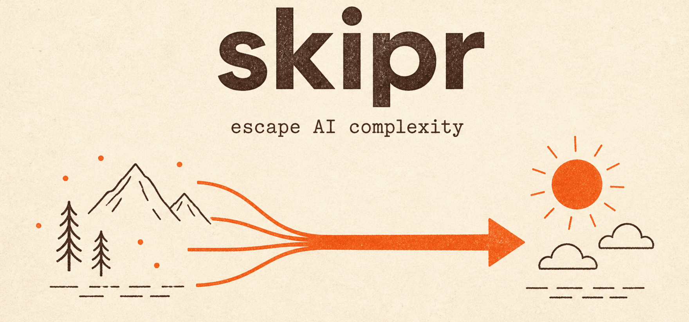

<div align="center">

# skipr

**Escape AI complexity** — terminal taught · Claude Code · harness that can say *no* · FDD · Fast Driven Development



[](#novice-path)
[](#what-skipr-is)
[](./skills/setup-harness/)
[](#a-note-on-branding)
[](#fdd--fast-driven-development)

</div>

---

**Escape AI complexity.** Few good tools, a harness that can say *no*, and guides by level — Claude Code first. The terminal (Ghostty or yours) is **taught, not hidden**. Rails, not 400 skills.

> This repository **is** the product presentation for now: README + docs + the vendored `setup-harness` skill. A marketing site may return later; personal-site embedding under [mariogarridotorres.com](https://mariogarridotorres.com) is later too.

## What skipr is

skipr helps **creators and builders drowning in AI tooling** set up a lean path you can understand:

| Piece | Role |
|---|---|
| **Terminal** | Ghostty (or Terminal.app / iTerm) — one calm place to work |
| **Agent** | Claude Code CLI in the **project folder** |
| **Harness** | Short `CLAUDE.md` + `checks/` that can fail ([setup-harness](./skills/setup-harness/)) |
| **Method** | [FDD · Fast Driven Development](#fdd--fast-driven-development): a short note, small slices, a check that can fail, and your review before anything counts as done |
| **Guides** | L0/L1 usable now · [for photographers](./docs/for-photographers.md) · [examples](./examples/) (photo-trip first-win) · optional [L2 tracks](./docs/l2/) |

You do **not** need another sealed AI stack or a rented no-code black box. You need a folder, a harness, and a CLI you can read.

## Who it’s for

- Photographers / creators who already try Claude in the app and want a folder-scoped setup — [for photographers](./docs/for-photographers.md)
- Builders stuck in skill hoards and “Second Brain” sprawl
- Anyone who wants **rails that can say no**, not more prompts — start with [examples](./examples/) (photo-trip first-win)

Software-founder desktop-app tracks from earlier MVPs are parked. Start here with L0/L1.

## Novice path

Full step-by-step: **[docs/novice-guide.md](./docs/novice-guide.md)** · [for photographers](./docs/for-photographers.md) · [examples](./examples/)

Do this in order (you do not need to be a developer):

0. **Two-minute fail/pass (no Claude yet)** — clone this repo, then:
   ```bash
   git clone https://github.com/mgatorr/skipr.git
   cd skipr/examples/photo-trip
   ./checks/naming.sh
   ```
   Red with a clear message is a win. How to pass: [`examples/photo-trip/checks/README.md`](./examples/photo-trip/checks/README.md).
1. **Install Claude Code CLI** — the `claude` command, not only the desktop app. Confirm with `claude --version`.
2. **Open a terminal you will actually use** — on macOS we recommend [Ghostty](https://ghostty.org); Terminal.app / iTerm are fine.
3. **Create or open your project folder** — a trip, client job, culling session — not a giant vault of prompts:
   ```bash
   mkdir -p ~/Projects/lisbon-trip
   cd ~/Projects/lisbon-trip
   ```
4. **Install and run setup-harness** — copy [`skills/setup-harness/`](./skills/setup-harness/) to `~/.claude/skills/setup-harness/`, then in the project folder:
   ```bash
   claude
   # "Run setup-harness for this folder"
   ```
5. **Run a checker** — see *no* work:
   ```bash
   ./checks/naming.sh   # or brief-ready.sh / delivery.sh
   ```
6. **First win** — `claude` runs here, short `CLAUDE.md`, at least one executable check, and you understand pass vs fail. You already saw fail/pass in step 0 on [`examples/photo-trip`](./examples/photo-trip/).

## FDD · Fast Driven Development

Once the harness works, FDD is how you build with it. Ask for an outcome, close the open questions in a short note, build in small slices, and review the result before it counts as done. There is no spec, plan and tasks chain, and FDD doesn't generate documents.

> **Not Feature-Driven Development.** In skipr, FDD always means **Fast Driven Development**. Feature-Driven Development is an older, unrelated method with the same initials. skipr isn't based on it and isn't linked to it.

### The flow

1. **Ask for an outcome** in one or two sentences, not a document.
2. **The agent explores first.** It reads the code, your `rules` and the `logbook` before it asks you anything.
3. **It sizes the job.** One step: it does it and runs the check. Two or more: it opens a short note.
4. **One question at a time**, and only about decisions it can't work out on its own. The note stays under 60 lines.
5. **Small slices.** For each one, it writes a check that fails, makes it pass and makes a small commit.
6. **Someone else tries to break it.** A different agent reproduces the result. Opinions don't count as a review.
7. **Review room.** You look at a preview of the build, then approve it or leave comments. A comment sends the work back to slices.
8. **Close.** The note becomes a logbook entry, any new rule is added, and the note is deleted.

Done means a check that can fail has passed and you've approved the build.

### Two layers of memory

| Layer | Where | When the agent reads it |
|---|---|---|
| `rules` | `.skipr/rules.md` | Every session. `CLAUDE.md` imports it with `@.skipr/rules.md`. 40 lines max: one rule per line, each with where it came from. |
| `logbook` | `.skipr/logbook/` | Only when needed. The agent searches it, starting at `INDEX.md`. One entry per finished feature. |

Every comment you leave in the review room is either a one-off fix or becomes one line in `rules`. If the same correction comes back, the rule gets rewritten or turned into a check, so you don't correct the same thing twice. It's all plain text in git, with no memory server, database or embeddings.

### Use it

Copy the skill (or use `./scripts/install-macos.sh`, which copies it too):

```bash
mkdir -p ~/.claude/skills/fdd
cp -R skills/fdd/. ~/.claude/skills/fdd/
```

`CLAUDE.md` is created by setup-harness first. Then start `.skipr/rules.md` in your project from [`skills/fdd/templates/rules.md`](./skills/fdd/templates/rules.md) and add `@.skipr/rules.md` to the project's `CLAUDE.md`.

```bash
mkdir -p .skipr
cp ~/.claude/skills/fdd/templates/rules.md .skipr/rules.md
```

Replace or delete the `<rule>` line. It is a placeholder. The templates for the note and the logbook are in the same folder. Full protocol: [`skills/fdd/SKILL.md`](./skills/fdd/SKILL.md).

## This grows with you

- **L0 / L1 are the product today** — terminal + Claude Code + harness + these guides.
- **L2 is optional** — [Cursor, OpenCode, Hermes](./docs/l2/) after L0/L1 feel solid. Complexity is not the door to getting started.

Levels overview: [novice guide](./docs/novice-guide.md#levels-l0--l2) · L2 field notes: [`docs/l2/`](./docs/l2/).

## Repository layout

```text
.
├── README.md                 # this product surface
├── CLAUDE.md                 # short harness; imports .skipr/rules.md
├── .skipr/                   # skipr's own FDD memory
│   ├── rules.md              # rules: loaded every session
│   └── logbook/              # logbook: searched when needed (INDEX.md + one entry per feature)
├── assets/
│   └── skipr-hero.png        # README hero (escape-complexity)
├── docs/
│   ├── novice-guide.md       # full beginner path
│   ├── for-photographers.md  # L0/L1 path for photographers
│   ├── l2/                   # optional advanced tracks (Cursor, OpenCode, Hermes)
│   └── ARCHIVE.md            # pointer to tag era-spec-kit
├── scripts/
│   ├── install-macos.sh      # macOS L0/L1 installer (v0)
│   └── README.md             # script usage
├── examples/                 # first-wins you can run (photo-trip fail/pass)
├── skills/
│   ├── setup-harness/        # vendored Claude Code skill + templates
│   └── fdd/                  # FDD · Fast Driven Development skill + templates (note, rules, logbook)
└── landing/                  # skipr.dev static GitHub stub (see landing/README.md)
```

## Historical docs

Earlier eras are on the tag `era-spec-kit`. See [`docs/ARCHIVE.md`](./docs/ARCHIVE.md). Do not treat that history as the current product.

## Language

- **Product / docs / README:** English (canonical).
- **Working chat with the human:** configurable — set `Working language: es` in project `CLAUDE.md`, or `SKIPR_LOCALE` / `LANG` (default `en`).
- Details: [`docs/language.md`](./docs/language.md). Product files stay English. Replies to the human may follow `Working language`.

## macOS installer (v0)

Lean setup on a Mac (Homebrew guidance, **optional** Ghostty, skill copy with backup, Claude Code pointers). **Clone first**, then run the script:

```bash
git clone https://github.com/mgatorr/skipr.git
cd skipr
./scripts/install-macos.sh
```

Ghostty is opt-in (`--with-ghostty` or interactive `y/N`). Details: [`scripts/README.md`](./scripts/README.md). Full steps: [novice guide](./docs/novice-guide.md). Tangible fail/pass demo: [`examples/photo-trip`](./examples/photo-trip/). Claude Code install: [Anthropic docs](https://code.claude.com/docs/en/install).

## Skill: setup-harness

Canonical source: **[`skills/setup-harness/SKILL.md`](./skills/setup-harness/SKILL.md)**

**Clone or download a zip of this repo first**, then copy the skill (or use `./scripts/install-macos.sh`, which backs up any existing copy):

```bash
mkdir -p ~/.claude/skills/setup-harness
cp -R skills/setup-harness/. ~/.claude/skills/setup-harness/
```

Templates (`CLAUDE.md`, checks, optional local skills) live next to the skill. Claude Code install: [code.claude.com/docs/en/install](https://code.claude.com/docs/en/install).

## Roadmap

- [x] Reposition promise: escape AI complexity (not “hide the terminal”)
- [x] GitHub-first product surface: README + novice guide + vendored harness
- [x] Install script v0 (macOS) — [`scripts/install-macos.sh`](./scripts/install-macos.sh)
- [x] L2 track docs (optional advanced tools) — [`docs/l2/`](./docs/l2/)
- [x] Examples (photo-trip first-win) — [`examples/`](./examples/)
- [x] Photographers guide — [`docs/for-photographers.md`](./docs/for-photographers.md)
- [x] FDD · Fast Driven Development: skill, `rules` and `logbook` — [`skills/fdd/`](./skills/fdd/)
- [ ] Personal-site / skipr.dev marketing — later, not blocking L0/L1

## A note on branding

**skipr is an independent project and is not affiliated with Anthropic.** “Claude” and “Claude Code” are trademarks of their respective owner. Ghostty, GitHub, Cursor, OpenCode, and Hermes are trademarks of their respective owners.


## License

[MIT](./LICENSE) — Copyright (c) 2026 Mario Garrido.

---

<div align="center"><sub>Built for people who want the rails — not another sealed box.</sub></div>
